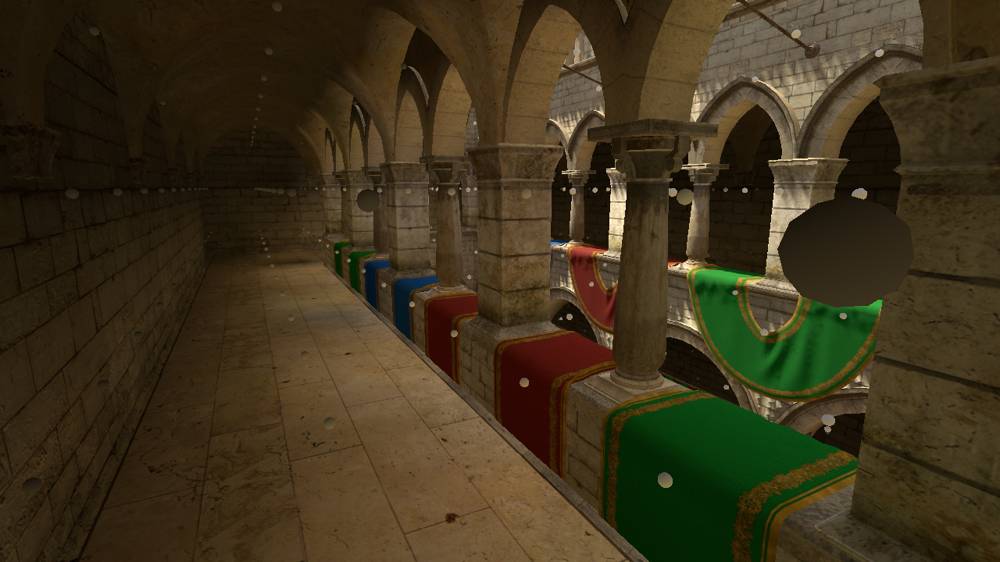

# FraxinusGraphics

[English](README.md) | [简体中文](README.zh-CN.md)

FraxinusGraphics is a custom rendering suite for **Unity 2022.3**. It combines RenderGraph rendering, cached cascaded shadows, STP/SGSR upscaling, external drawing interfaces and GPU probe baking across four companion packages.

[Why Fraxinus](#why-fraxinus-instead-of-standard-urp-14) · [Usage guide](docs/Usage.md) · [Source comparison](docs/URP14Comparison.md) · [Rendering preview](#rendering-preview)

## Why Fraxinus instead of standard URP 14?

The goal is to keep Unity 2022.3 while bringing newer rendering infrastructure and more control into the pipeline: reuse static shadow cascades, reconstruct lower-resolution frames, connect external scene renderers and bake probe lighting directly in URP. The work combines upstream backports, engine adaptation and Fraxinus extensions across Core, URP and the tracing backend.

## What changed from URP 14?

| Area | Standard URP 14 | Fraxinus |
| --- | --- | --- |
| [RenderGraph](docs/URP14Comparison.md#rendergraph) | Experimental graph path; public custom passes use `Execute`. | Raster / Compute / Unsafe passes throughout the pipeline, with a Native Pass Compiler bridge for Unity 2022. |
| [Cached shadows](docs/URP14Comparison.md#cached-csm) | Draws active main-light cascades. | Per-camera CSM caches, selective refresh and manual invalidation to reuse eligible cascades. |
| [Upscaling](docs/URP14Comparison.md#upscaling) | Bilinear/nearest filtering and FSR 1; TAA is available. | Adds STP, SGSR1 and SGSR2, with jitter, motion vectors and history scheduling for temporal reconstruction. |
| [HZB and external drawing](docs/URP14Comparison.md#hzb-and-external-drawing) | Renderer Features and custom passes. | Depth-pyramid snapshots plus camera, depth/normal and shadow hooks for instancing or terrain backends. |
| [Adaptive Probe Volumes (APV)](docs/URP14Comparison.md#apv) | Core contains APV infrastructure; URP lacks the complete rendering workflow. | Standalone Compute baking and URP material sampling, with adaptive placement, sky occlusion, scenarios and streaming. No DXR required. |
| [Adaptive PRT Volumes (APRTV)](docs/URP14Comparison.md#aprtv) | No equivalent precomputed transport workflow. | Directional-light/HDR-sky relighting for baked static geometry, multiple Baking Sets, two-scenario blending and per-camera controls. |
| [Compute ray queries](docs/URP14Comparison.md#light-transport) | No companion Compute ray-query library in Core 14. | BVH construction, hit/occlusion queries and sampling for baking and custom integrations. |

Each area links to the implementation and upstream source comparison. Forward, Forward+, Deferred, 2D, ShaderGraph, camera stacking, RTHandle, Volume and Blitter remain part of the inherited URP/Core foundation.

## Packages

| Package | Version | Responsibility |
| --- | --- | --- |
| [Fraxinus-RPCore](Packages/Fraxinus-RPCore/README.md) | `14.0.99` | Shared rendering infrastructure, probe data and baking workflows. |
| [Fraxinus-URPExtensions](Packages/Fraxinus-URPExtensions/README.md) | `14.0.99` | Frame rendering, shadows, upscaling and external renderer integration. |
| [Fraxinus-URPGlobal](Packages/Fraxinus-URPGlobal/README.md) | `14.0.99` | Platform light limits shared by C# and generated HLSL. |
| [Fraxinus-Light-Transport](Packages/Fraxinus-Light-Transport/README.md) | `1.0.1` | GPU acceleration structures, ray queries and sampling. |

Core owns the [graph APIs](Packages/Fraxinus-RPCore/Runtime/RenderGraph/RenderGraph.cs), [Unity 2022 compiler bridge](Packages/Fraxinus-RPCore/Runtime/RenderGraph/Compiler/NativePassCompiler.2022.cs) and [APV baker](Packages/Fraxinus-RPCore/Editor/Lighting/APV/ProbeGIBaking.Standalone.cs). URP connects them to cameras, passes and [material lighting](Packages/Fraxinus-URPExtensions/ShaderLibrary/GlobalIllumination.hlsl). Use the four packages from the same checkout so rendering, baking and shader configuration stay aligned.

## Start using it

1. Reference all four packages using the relative paths in the [usage guide](docs/Usage.md#use-in-a-project).
2. Create or select a URP Asset and assign it in **Project Settings > Graphics**; check the active **Quality** override too.
3. Enable cached shadows in **Lighting**, select an upscaler in **Quality**, or add RenderGraph features to the active Renderer. Probe lighting is selected separately under **Light Probe System**.

See [feature controls](docs/Usage.md#feature-controls), [probe baking](docs/Usage.md#probe-lighting) and [common setup issues](docs/Usage.md#common-setup-issues). Detailed probe documentation and bake controls use the shorter name **APRT** for the APRTV system.

## Rendering preview

Same camera and lighting; APRTV GI intensity changes from 0 to 1. [More probe-lighting captures and capture conditions](docs/Screenshots.md).

Probe Volume debug view (APRTV backend). The spheres show probe positions and lighting response; the scene has 4,563 resident probes.

Captured in a separate Sponza demo. This repository contains the four packages; the demo scene is not included.

## Compatibility

- Custom passes must implement `RecordRenderGraph`; migrate extensions that only implement `Execute`.
- Refresh cached shadows for scene changes the cache does not track. Check the upscaler's camera and device requirements before enabling it.
- APRT needs rebaking after geometry/material edits, does not handle dynamic occlusion, and keeps all cells of loaded scenes resident. APV supports streaming.
- Light Transport's C# APIs are currently `internal`; direct integration requires assembly access.

See the [usage guide](docs/Usage.md) for configuration and the [source comparison](docs/URP14Comparison.md) for implementation limits.

This is an independently maintained Unity fork. Unity-derived code follows the [Unity Companion License](Packages/Fraxinus-RPCore/LICENSE.md); individual packages retain their third-party notices.
