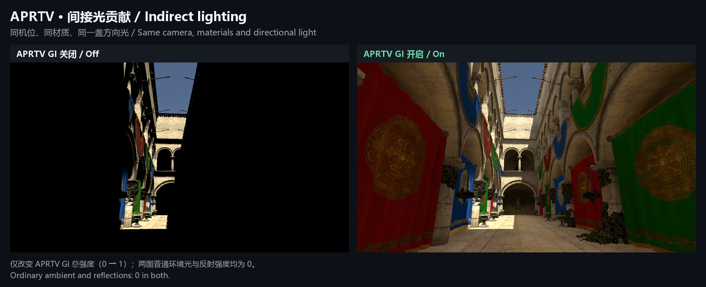

# FraxinusGraphics

[English](README.md) | [简体中文](README.zh-CN.md)

FraxinusGraphics brings RenderGraph rendering, cached cascaded shadows, spatial and temporal upscaling, external drawing interfaces, and GPU probe baking to Unity 2022.3. Four companion packages connect frame rendering, lighting tools and compute ray queries in one source tree.

[Why Fraxinus](#why-fraxinus-instead-of-standard-urp-14) · [Usage guide](docs/Usage.md) · [Source comparison](docs/URP14Comparison.md) · [Rendering preview](#rendering-preview)

## Why Fraxinus instead of standard URP 14?

Fraxinus targets projects staying on **Unity 2022.3** that need a newer RenderGraph workflow, more control over shadow updates, temporal upscaling, external renderer integration and richer probe-lighting workflows. It adapts newer rendering infrastructure to that engine version and adds the missing baking and runtime integration across the four packages.

The upgrade is in rendering control and available workflows. Cached shadows can avoid eligible cascade redraws; lower-resolution rendering can use STP/SGSR reconstruction; APV can be baked and consumed within this URP; custom renderers can share depth and drawing stages. The benefit depends on which of these capabilities a project uses.

## What changed from URP 14?

| Area | Standard URP 14 | Fraxinus change and purpose |
| --- | --- | --- |
| RenderGraph | Experimental graph code exists alongside the classic `Execute` path; graph execution is gated. | Uses the newer Raster / Compute / Unsafe Pass model as the pipeline's execution path, with a Native Pass Compiler bridge for Unity 2022. Custom passes declare resources and dependencies in the same workflow. [Sources](docs/URP14Comparison.md#rendergraph). |
| Main-light shadows | Renders the active shadow cascades without this per-camera CSM reuse policy. | Adds persistent cascade caches, selective refresh and manual invalidation, allowing unchanged eligible cascades to be reused. [Sources](docs/URP14Comparison.md#cached-csm). |
| Upscaling | Includes bilinear/nearest filtering and FSR 1; TAA is already present. | Adds STP, SGSR1 and SGSR2, including the temporal paths' jitter, motion vectors and history scheduling. Projects gain more reconstruction choices at reduced render scale. [Sources](docs/URP14Comparison.md#upscaling). |
| HZB and custom renderers | Provides Renderer Features and custom passes. | Adds CPU/GPU depth-pyramid snapshots and camera, depth/normal and shadow hooks for external instancing or terrain backends. [Sources](docs/URP14Comparison.md#hzb-and-external-drawing). |
| APV baking and rendering | Core already contains APV infrastructure, but URP 14 does not provide the complete APV rendering workflow. | Connects APV to URP materials and supplies standalone Compute baking, adaptive placement, sky occlusion, scenarios and APV streaming. Probe baking needs no DXR. [Sources](docs/URP14Comparison.md#apv). |
| Relightable volumes | Does not ship this APRTV transport and relighting system. | Adds directional-light/HDR-sky relighting, multiple Baking Sets, two-scenario blending and per-camera Volume controls for baked static geometry. [Sources](docs/URP14Comparison.md#aprtv). |
| GPU ray queries | Core 14 does not include this companion Compute ray-query library. | Light Transport supplies BVHs, hit/occlusion queries and sampling for the baker and custom integrations. Direct C# access currently requires assembly access to internal APIs. [Sources](docs/URP14Comparison.md#light-transport). |

Forward, Forward+, Deferred, 2D rendering, ShaderGraph, camera stacking, RTHandle, Volume and Blitter are retained foundations that already exist in the URP/Core 14 generation. Fraxinus combines these with the newer graph workflow and rendering diagnostics; they are not counted as new inventions.

## Packages

| Package | Version | Responsibility |
| --- | --- | --- |
| [Fraxinus-RPCore](Packages/Fraxinus-RPCore/README.md) | `14.0.99` | Shared rendering infrastructure, probe data and baking workflows. |
| [Fraxinus-URPExtensions](Packages/Fraxinus-URPExtensions/README.md) | `14.0.99` | Frame rendering, shadows, upscaling and external renderer integration. |
| [Fraxinus-URPGlobal](Packages/Fraxinus-URPGlobal/README.md) | `14.0.99` | Platform light limits shared by C# and generated HLSL. |
| [Fraxinus-Light-Transport](Packages/Fraxinus-Light-Transport/README.md) | `1.0.1` | GPU acceleration structures, ray queries and sampling. |

Core owns the [graph APIs](Packages/Fraxinus-RPCore/Runtime/RenderGraph/RenderGraph.cs), [Unity 2022 compiler bridge](Packages/Fraxinus-RPCore/Runtime/RenderGraph/Compiler/NativePassCompiler.2022.cs) and [standalone APV baker](Packages/Fraxinus-RPCore/Editor/Lighting/APV/ProbeGIBaking.Standalone.cs). URP connects them to cameras, render passes and [material lighting](Packages/Fraxinus-URPExtensions/ShaderLibrary/GlobalIllumination.hlsl); Light Transport supplies tracing, while Global keeps C# and HLSL configuration aligned. These changes cross package boundaries, so the four packages are maintained together.

## Start using it

1. Reference all four local packages from one checkout. The [usage guide](docs/Usage.md#use-in-a-project) includes the relative-path `manifest.json` entries.
2. Create or select a URP Asset and assign it in **Project Settings > Graphics**; check the active **Quality** override too.
3. Enable cached shadows in **Lighting**, select an upscaler in **Quality**, or add RenderGraph features to the active Renderer. Probe lighting is selected separately under **Light Probe System**.

The guide includes [feature controls](docs/Usage.md#feature-controls) and [APV/APRT baking steps](docs/Usage.md#probe-lighting). URP Global and Light Transport need no extra scene components for these built-in workflows.

## Rendering preview

Same camera and lighting, with APRTV indirect lighting off and on. [GI response and probe visualization](docs/Screenshots.md).

The images were captured from a separate Sponza demo; this repository contains package source.

## Compatibility

Custom passes use `RecordRenderGraph`; `Execute`-only extensions require migration. Cached shadows need explicit refresh for changes the cache does not track. Temporal upscalers have camera/device requirements. APRT requires rebaking after geometry or material changes and does not handle dynamic occlusion. These capabilities do not guarantee higher FPS or better images in every scene. Projects fully served by standard URP 14 can avoid the maintenance cost of a custom pipeline. See the [comparison](docs/URP14Comparison.md) and [usage guide](docs/Usage.md) for the boundaries.

This is an independently maintained Unity fork. Unity-derived code follows the [Unity Companion License](Packages/Fraxinus-RPCore/LICENSE.md); individual packages retain their third-party notices.
