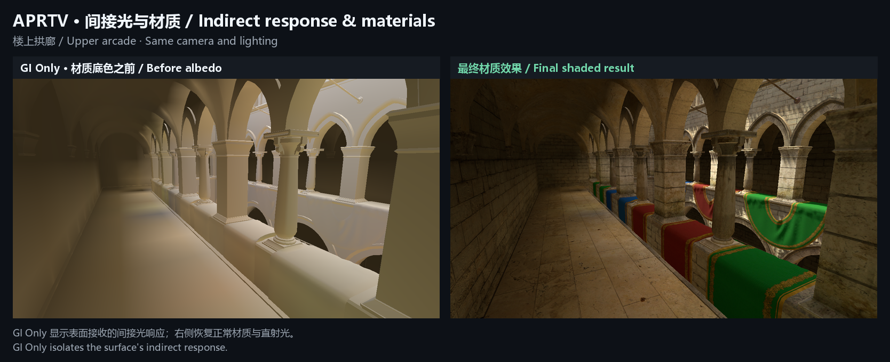
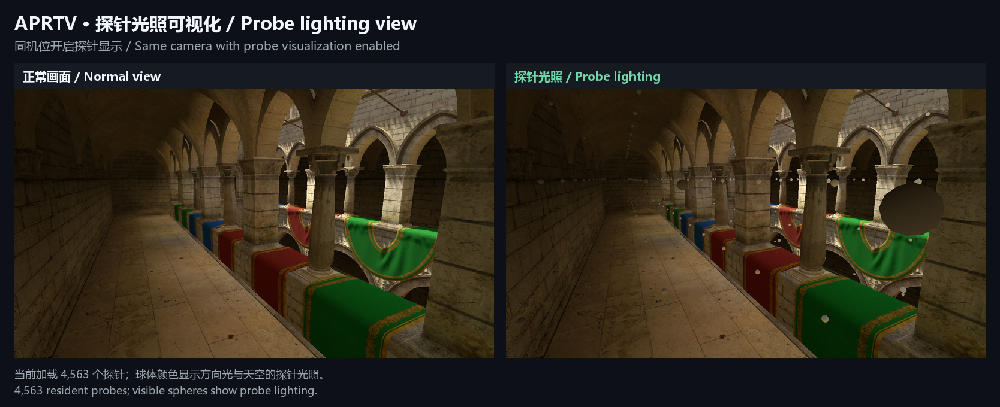

# Probe lighting captures / 探针光照截图

[English README](../README.md) | [中文 README](../README.zh-CN.md)

Captured from a separate Sponza demo in Unity 2022.3 on 2026-10-18. Each pair uses the same camera and lighting. Images are unretouched; comparison sheets only resize them and add labels. The demo scene is not included in this repository.

2026-10-18 从 Unity 2022.3 中独立的 Sponza Demo 实际渲染中采集。每组对比固定机位和灯光，画面未调色；对比图仅缩放排版并添加说明。Demo 场景不包含在本仓库中。

**APRTV indirect lighting / APRTV 间接光贡献**

Only APRTV GI intensity changes from 0 to 1. Ordinary ambient and reflection intensity are zero in both images, isolating APRTV's contribution to the shaded surfaces.

仅将 APRTV GI 总强度从 0 切换到 1。两图的普通环境光和反射强度均为 0，用于观察 APRTV 对暗部表面的贡献。

**Indirect response and materials / 间接光与材质效果**

GI Only displays the received indirect response before material albedo. The normal view includes materials and direct lighting.

GI Only 显示乘材质底色前的间接光响应，正常视图则呈现材质与直射光共同参与的最终效果。

**Probe lighting visualization / 探针光照可视化**

The APRTV backend has 4,563 resident probes in this scene. Visible spheres show probe positions and lighting response.

当前场景通过 APRTV 后端加载了 4,563 个探针。可见球体用于显示探针位置及光照响应。

[Full-size Probe Volume debug capture / 完整尺寸的 Probe Volume 调试截图](images/aprtv-balcony-probes.png)

[Capture parameters and image hashes / 采集参数与图片校验值](capture-manifest.json)
